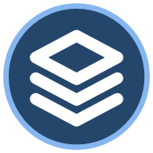

<p align="center">
  
</p>

<h1 align="center">AI Deck</h1>

<p align="center">Codex + Claude Code, working together in one desktop workspace.</p>

<p align="center">
  <strong>Windows x64 · Desktop 0.9.155</strong><br />
  <a href="#quick-start-on-windows">Quick start</a> ·
  <a href="#working-with-a-team">Team workflows</a> ·
  <a href="docs/validation.md">Validation &amp; limitations</a>
</p>

AI Deck connects your signed-in Codex CLI and Claude Code so you can continue existing chats, assign team roles, pass evidence between agents and read the combined answer in one place. You can run either provider alone; both providers are needed for a Codex–Claude team. You do not need to keep their desktop apps open.

## What you can do

| Feature | How it works |
| --- | --- |
| Continue existing chats | Recents opens the original Codex or Claude conversation and keeps its native session ID. Chat only works without Git. |
| Work as a team | Choose members, roles, models and handoff order in Session Team. A builder can pass its changes and evidence to a reviewer. |
| Share context | Use project instructions, selected messages, local notes and skill snapshots, with sharing controlled per team. |
| Attach files | Paste or drop images, PDF, DOCX, XLSX and UTF-8 files. Document extraction and Thai/English scanned-PDF OCR run locally. |
| Control each chat | Choose the provider's available Model, Effort and Speed, plus Chat only, Ask for approval, Approve for me or Full access. |
| Follow progress | See session activity, question times, queued follow-ups, expandable work steps and completion notifications. |
| Track usage | View reported account limits, reset times and per-run token reports separately. Unknown usage stays unknown. |
| Keep work isolated | Run independent sessions on verified Git worktrees, with bounded concurrency and a Low RAM option. |

This is an actively developed application. Provider/account capabilities vary, and AI Deck does not reproduce every feature of the native desktop apps. See [validation and release scope](docs/validation.md) for exercised paths and proof boundaries.

## Quick start on Windows

Install Git for Windows and Node.js 24 on Windows x64. In PowerShell, run:

```powershell
git clone https://github.com/Wariddon/ai-deck.git
cd ai-deck
npm.cmd ci
npm.cmd start
```

`npm.cmd ci` installs the npm dependencies. `npm.cmd start` prepares the Electron runtime, builds the renderer and launches the desktop app. The first start or test run may download Electron; later runs reuse that runtime. Tests finish this preparation before starting parallel workers.

Install and sign in to the Codex CLI, Claude Code, or both on your own machine. Open **Connections** in AI Deck to verify sign-in. If a CLI is missing, select its Windows executable there and refresh. One connected CLI is enough for solo work. Team discussion and two-agent workflows require both.

Open a Git repository from **Projects** for project file work, or pull **Recents** to continue an existing provider chat. Account sign-in, workspace settings, drafts and chat history stay in your own local profile; cloning this repository does not include another user's account or conversations.

## Working with a team

1. Open a task and choose **Session Team** below the composer.
2. Set each member's provider, role, model and responsibilities. Reorder members or use the team map to define handoffs.
3. Send your request normally. The next member receives the permitted brief, relevant evidence and upstream report.
4. Read the combined answer in the chat; expand work steps and individual reports when needed.

The compact direction picker inside the composer switches between **Codex → Claude**, **Claude → Codex** and bounded two-way discussion. **Fork to Team** starts a separate team chat from an existing conversation, without changing the source chat; its Chat only mode needs no project or Git. Optional Gemini and local Ollama members are configured in **Accounts & connections**, with separate data-sharing controls.

New persistent provider chats get a short name from the task without an extra model request. Rename a session through its **…** menu or **F2**. Resumed chats keep their names and IDs. Running chats show an activity ring; waiting for a resource or an approval has its own status.

An older incomplete plan appears as a quiet note while chat stays available. Hiding the note preserves its evidence in Run history and does not approve edits or change the checkout.

## Multiple chats at once

Start a task, then choose another chat or **New task** in the sidebar. The earlier job keeps running, with an activity ring beside its name. Stop, approvals and follow-up queues apply to the selected job. Reopening a running chat restores its available reply and pending requests.

The app runs up to two independent jobs at once by default, or one with **Low RAM** enabled. Additional jobs wait for a slot or available memory. Jobs that use the same original provider conversation or overlapping writable folders wait for each other. Project tasks use their own Git worktrees, and members inside a team keep their configured execution order. Waiting project requests recover as paused messages after restart; they are not sent again automatically.

Original Codex and Claude conversations retain their provider session IDs. The app verifies the recorded folder and transcript before each send. Choose the permission mode below the composer when you want file or command tools; **Chat only** does not require Git.

The model button beside permissions sets **Model**, **Effort** and **Speed** for the original chat. The list comes from the connected provider; Fast is enabled only for reported model/account support. Choices are saved per provider, native conversation ID and verified folder. Leaving a field at its chat default preserves the original CLI behavior. Changes apply on the next send and do not create a new conversation or change its permissions.

## Files, screenshots and browser tools

Use the paperclip for files, screenshot preview or a one-turn window share. Images appear as thumbnails inside the composer. Original Recents chats use the same extraction/OCR pipeline as team tasks, and attachment drafts survive reopening the app. Delayed imports merge with the latest draft rather than replacing newer text or files.

Both reviewers can search task text and read source lines through bounded read-only tools. The shared-window bridge supports accessible controls, scrolling and navigation keys, with fresh inspection and one-action approval. It controls one selected window at a time. Hiding or minimizing AI Deck ends window access; **Stop sharing** is separate from stopping the model. Window access does not increase file permissions.

An explicit Chrome request to Claude, such as `@Chrome`, enables Claude Code's native Chrome integration for that turn. Install/connect the provider's official browser extension first. Ordinary messages do not load Chrome tools. Browser changes retain one-action approval even with Full access for files, and hiding AI Deck ends the browser turn.

The Codex Cloud bridge can read task lists, status and diffs through the signed-in official CLI. It does not create or apply cloud tasks. Native local-memory preferences and opt-outs are preserved; private ChatGPT/Claude account memory is not copied between providers.

Arbitrary coordinate dragging, simultaneous multi-window control, native realtime voice and full provider-cloud workspace management are not implemented. Voice supports local transcription, chat and Windows text-to-speech when the optional runtime is available.

## Settings and updates

Settings has 13 searchable categories: **General**, **Appearance**, **Notifications**, **Accounts & connections**, **Voice**, **Models**, **Project**, **Shared knowledge**, **Skills & plugins**, **Screen & browser**, **Hooks**, **Git & worktrees** and **Advanced settings**.

UI scale and text size are saved locally. Keyboard help lives in General, archives in Recents, and billing/account limits in Usage. Infrequent import, provider configuration, storage and privacy actions are grouped in Advanced. Local scheduling has been removed; earlier schedule history is retained paused and is not replayed.

The header bell checks Codex and Claude desktop/CLI update metadata while idle, remembers read versions and opens official update pages. Desktop availability comes from the Windows catalog; CLI releases come from publisher package catalogs, respecting Claude's stable channel. It does not install updates or send model prompts automatically. Unknown or offline checks do not create new update alerts.

## Automatic Git and code tools

Project turns automatically receive a small, checkout-scoped MCP toolset for Git reads and Serena symbol/reference lookup. Both providers can use it, including reviewers. File edits keep the existing native tools and permission mode. Bounded tool observations are quoted to the next teammate and attributed in the run details. Services close when the run ends or is stopped; there is no feature switch.

Serena starts on the first code lookup. With Python 3.11 or newer available, AI Deck prepares a private, commit-pinned runtime and language-server dependencies on first use. If preparation or a lookup is unavailable, it identifies the fallback as a partial local JS/TS graph. For a packaged installation the runtime is under the app's `tools` directory; source runs use the desktop profile's `tool-runtimes` directory.

Requests mentioning GitHub, PRs, issues, CI or workflows also receive a read-only GitHub MCP tool bound to the checkout's `github.com` origin. It uses `GH_TOKEN`, `GITHUB_TOKEN`, or existing Git Credential Manager authentication in memory. A Codex connector sign-in is separate. Missing GitHub access does not disable local Git or code tools. The curated tools do not commit, push, merge or publish, and they do not invoke another LLM; their returned evidence still contributes to the model's context.

## Test and package

```powershell
npm.cmd test
npm.cmd run package:windows
```

Packaging prints the paths to the staged executable and the portable ZIP. Unzip the entire archive and run `AI Deck.exe`. Recipients configure their own CLIs. Leave `AI_DECK_CODEX_EXE` and `AI_DECK_CLAUDE_EXE` unset when building for others. Those optional overrides embed absolute executable paths for machine-local builds.

Voice transcription is optional. To enable it from source or bundle it into the ZIP, set `AI_DECK_VOICE_DIR` to a folder with the Windows Whisper binaries and license in `whisper/` and `ggml-base-q5_1.bin` in `models/`.

After publishing a successful package, cleanup retains the latest three release versions, including their ZIPs and one completed stage per version. Active builds and running staged apps are preserved, and locked cleanup is retried after a later successful package. `--keep-stage` retains the completed QA stage while still respecting this release limit.
